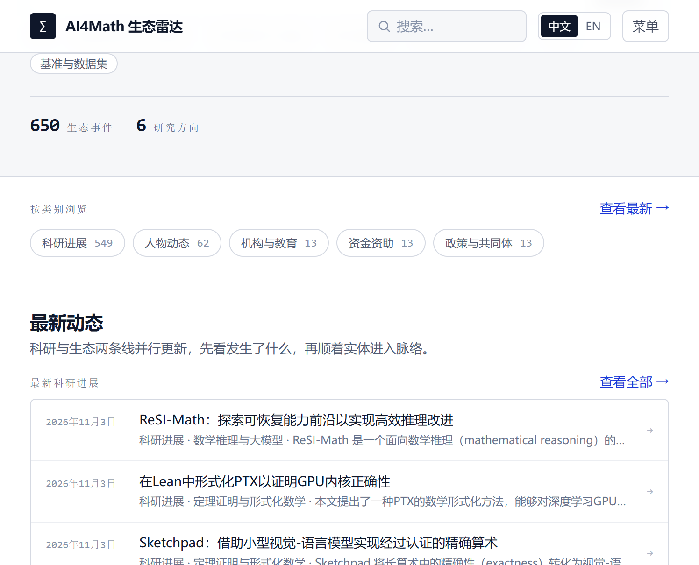
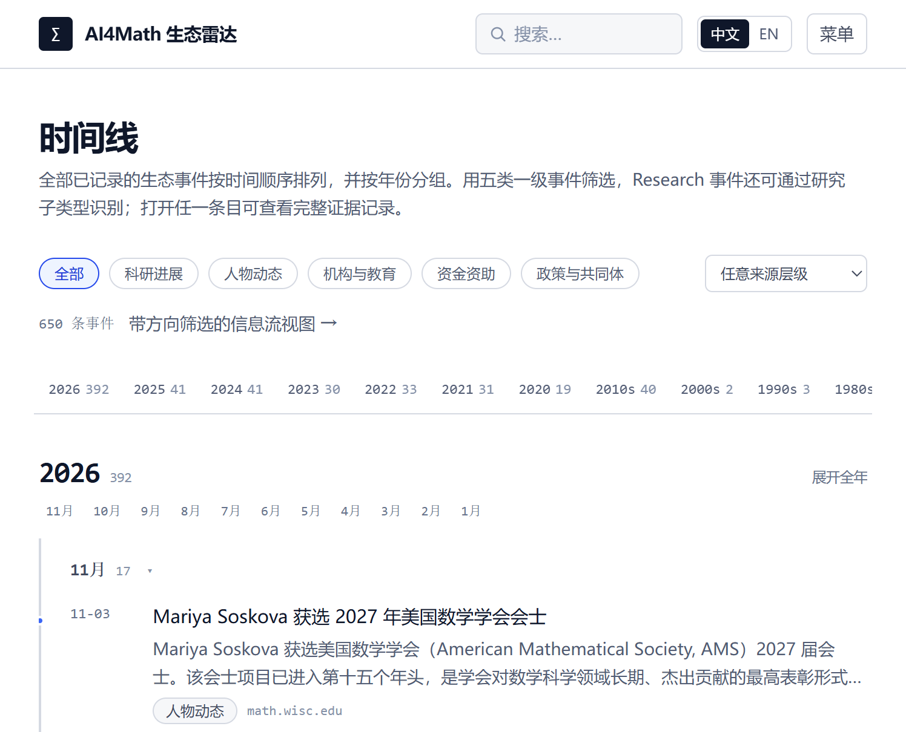
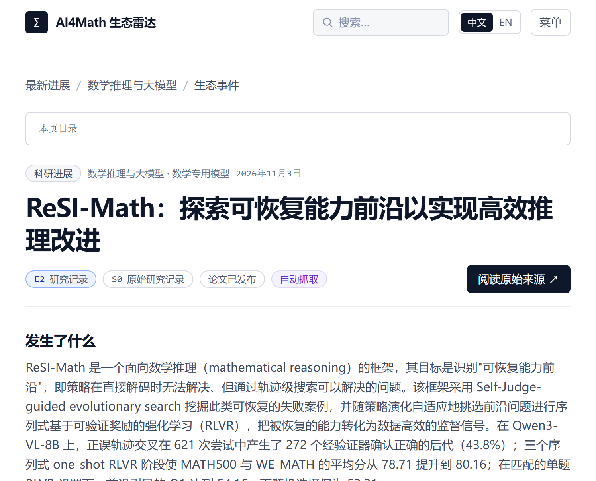

<div align="center">

# ∑ AI4Math Ecosystem Radar

**An ecosystem intelligence platform for AI for Mathematics — tracking events, not just papers.**

Turning progress scattered across arXiv, conference proceedings, lab blogs, university news
and foundation announcements into one filterable, traceable, navigable timeline.

**English** · [中文](README.md) · [Weekly updates](project_management.md)

[](https://nextjs.org/)
[](https://react.dev/)
[](https://www.typescriptlang.org/)
[](https://tailwindcss.com/)
[](#how-data-updates)
[](https://vitest.dev/)



</div>

---

## What it is

AI4Math does not advance in papers alone. New methods appear, researchers move, institutions
open joint labs, foundations issue calls, communities publish policy statements — these
events shape a field, yet they are scattered across dozens of sources with different
formats and rhythms.

**AI4Math Ecosystem Radar** puts six research areas and five classes of ecosystem events
into a single dataset. Every event keeps its original source link, evidence level and
verification record. Filter by area, class, time or evidence level, or follow a field on
the timeline to see how it got here.

Current dataset: **~650 events**, dating back to **1956**, across **6 research areas**.

## Design principles

<table>
<tr><td width="33%" valign="top">

### Events, not papers

Papers, models, benchmarks and datasets are **properties of an event**, never a top-level
class. The five ecosystem classes sit side by side: Research, People, Institutions &
Education, Funding, Policy & Community.

</td><td width="33%" valign="top">

### Evidence apart from importance

`evidenceLevel` (E0–E4) says how mature the public evidence is; `sourceTier` (S0–S4) says
where it comes from. They are labelled independently and never merged into one score.

</td><td width="33%" valign="top">

### Automated and traceable

Ingested events go straight into the stream with no manual review queue. Unverifiable
fields stay empty; items without a confirmable source URL are dropped.

</td></tr>
</table>

## Features

| Module | Route | What it does |
| --- | --- | --- |
| Home | `/` | Event totals, area distribution, latest events and recent activity |
| Feed | `/latest` | Class / area / time / evidence / tier filters, search, card and compact views |
| Timeline | `/timeline` | Year-by-year from 2020, decades before that; month folding, deep links, expand-all |
| Areas | `/topics` · `/topics/[topic]` | Trends, papers, models, benchmarks and events for each area |
| Event detail | `/research/[slug]` | What happened, key facts, evidence and status, related events, and the **event thread** |
| Search | `/search` | Results grouped by event, paper, area, model and benchmark |
| Sources | `/sources` | Last sync status and cursor per source |
| Glossary | `/methodology` | Full definitions of evidence levels and source tiers |

**Event thread**: the detail page places an event on a co-occurrence timeline built from
the people, institutions, projects, models and benchmarks it names, marking the earliest
point, the latest development and the current event. Co-occurrence plus ordering expresses
association, not causation.

**Trust model**: evidence levels E0–E4 (independent replication / testable artifact /
research record / originator claim / no evidence) and source tiers S0–S4 are labelled
separately; verification history is append-only. Rules live at
[`/methodology`](app/methodology/page.tsx).

<table>
<tr>
<td width="50%"><br><sub>Timeline: grouped by year, months foldable</sub></td>
<td width="50%"><br><sub>Event detail: facts, evidence and original source</sub></td>
</tr>
</table>

## Data and trust model

Each event's evidence level is derived from verifiable links, not a subjective score:

```text
E0 Independent replication  Multiple independent sources cross-check
E1 Testable artifact        Public code / data / formal proof
E2 Research record          Paper, proceedings or technical report
E3 Originator claim         Only the originating party's public statement
E4 No evidence              No public material yet
```

Source tier `S0`–`S4` is labelled separately and resolved in this order: explicit event
override → source catalog table → source-type fallback. arXiv and GitHub are both `S0`.

Data policy:

- Never invent results, arXiv IDs or URLs; leave unverifiable fields empty and drop items
  whose source URL cannot be confirmed.
- Publisher-reported results are recorded as originator claims with denominators kept
  (e.g. counted by published statements, not by proven theorems).
- Ingested entries go straight into the stream; there is no manual review queue, and
  corrections are appended to verification history.
- Event titles keep the source's original wording and are never rewritten automatically.

## How data updates

The site is a fully static export: data is written to JSON at build time, pages are
exported as HTML, and there is no server process or database. Sources are registered in
`lib/sources/catalog.ts`; each sync appends new events to `data/ingested/`, which are
merged with the bundled events, deduplicated, and turned into the Chinese and English
datasets at build time.

Publishing is handled by [`.github/workflows/publish.yml`](.github/workflows/publish.yml):
on every push to `main`, every 6 hours, or on manual dispatch. Scheduled and manual runs
pull new events first, then rebuild and publish both language sites.

## Running locally

Requires Node.js 20+:

```bash
npm install
npm run dev
```

The Chinese site runs at <http://localhost:3000> and English at
<http://localhost:3001/en/>.

## Roadmap

- [x] Five-class ecosystem event model with trust labels
- [x] Static export with separate Chinese and English builds
- [x] Timeline (year / decade grouping, month folding, deep links)
- [x] Event threads across people, institutions, projects, models and benchmarks
- [x] Scheduled ingestion and automated publishing
- [ ] Citation graph between events, replacing pure co-occurrence threads
- [ ] Per-problem benchmark result tracking within areas
- [ ] Math4AI as a first-class entry

## Contributing

Found an error or want to suggest a source? Open an issue with a verifiable original link;
items without a confirmable source are not merged. Weekly feature updates live in
[project_management.md](project_management.md).

## License

No open-source license has been chosen yet. Until a `LICENSE` file is added, all rights are
reserved; please contact the author before reuse.
