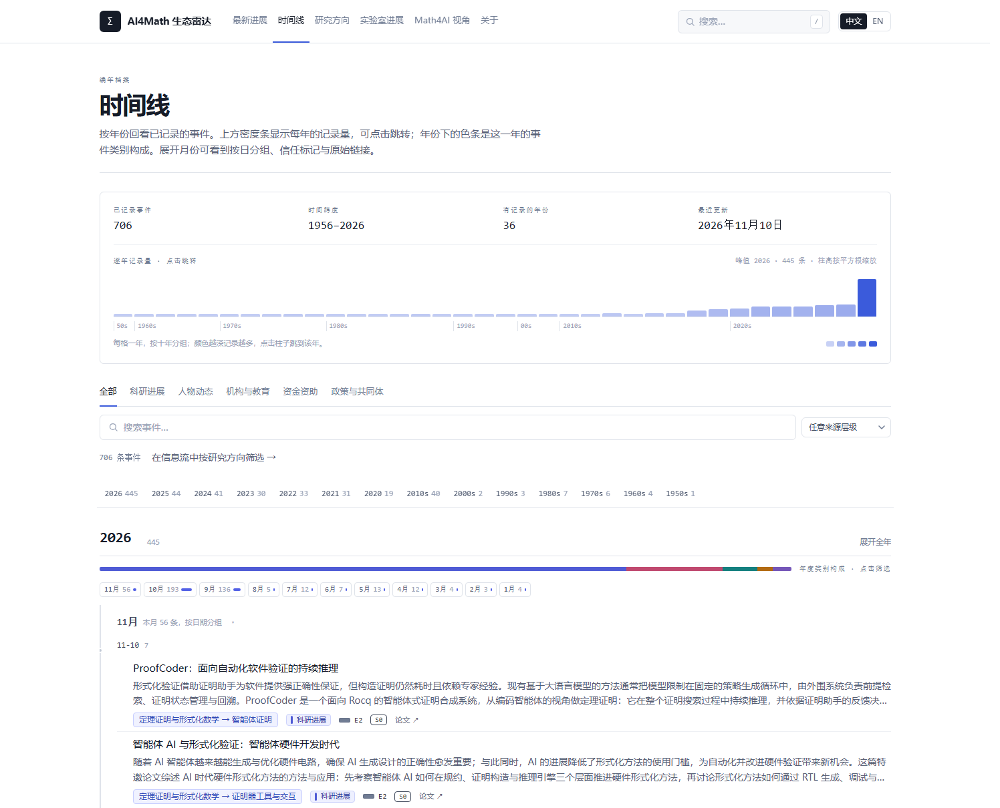
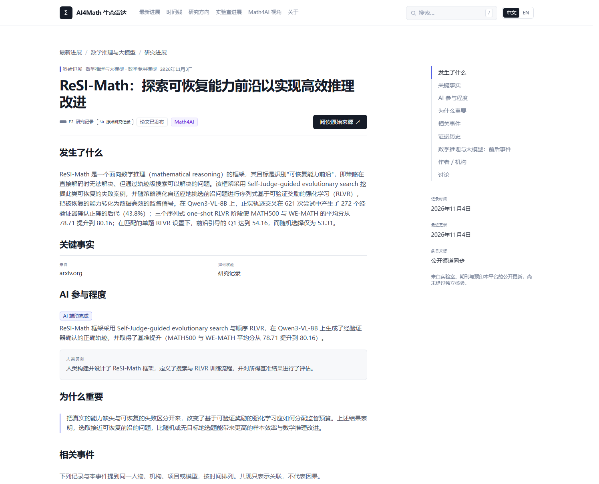

<div align="center">

# ∑ AI4Math Ecosystem Radar

**An ecosystem intelligence platform for AI for Mathematics — tracking events, not just papers.**

Turning progress scattered across arXiv, conference proceedings, lab blogs, university news
and foundation announcements into one filterable, traceable, navigable timeline.

**English** · [中文](README.md) · [Weekly updates](project_management.md) · [Live site](https://irrelaceable.github.io/ai4math-radar/)

[](https://nextjs.org/)
[](https://react.dev/)
[](https://www.typescriptlang.org/)
[](https://tailwindcss.com/)

[](https://vitest.dev/)


</div>

---

## What it is

AI4Math does not advance in papers alone. New methods appear, researchers move, institutions
open joint labs, foundations issue calls, communities publish policy statements — these
events shape a field, yet they are scattered across dozens of sources with different
formats and rhythms.

**AI4Math Ecosystem Radar** puts research progress and five classes of ecosystem events
into a single dataset. Every event keeps its original source link, evidence level and
verification record. Filter by class, classification dimension, time or evidence level, or follow a field on
the timeline to see how it got here.

## Design principles

<table>
<tr><td width="50%" valign="top">

### Events, not papers

Papers, models, benchmarks and datasets are **properties of an event**, never a top-level
class. The five ecosystem classes sit side by side: Research, People, Institutions &
Education, Funding, Policy & Community.

</td><td width="50%" valign="top">

### Automated and traceable

Ingested events go straight into the stream. Unverifiable fields stay empty;
items without a confirmable source URL are dropped.

</td></tr>
</table>

## Features

The site offers seven modules, each answering a different question:

| Module | What it does |
| --- | --- |
| Latest | Browse all events in time order, filter by class, theme, math topic, evidence level and date, with keyword search |
| Timeline | Look back by year and month, see yearly counts and class mix, and jump to any year |
| Research Graph | Explore event distribution in a scatter view and math-topic × research-theme counts in a matrix, with click-through to records |
| Math Archive | Review published math problems and evaluation cases, comparing model answers, status and resource use across models |
| Math4AI | See the distribution of "math improving AI" research, filtering by year, theme or topic |
| Search | Search events, papers, models and benchmarks across all records, in both Chinese and English |
| Event Detail & Tracking | Follow a single event's background, follow-ups, verifications and corrections, and related coverage |

**Citation links and related events**: the detail page keeps the two relations apart.
"Citation links" lists works in this event's reference list and later works citing it,
each with a link to the original paper; a citation is a documented link, not a claim that
conclusions carry over. "Related events" groups co-occurring people, institutions, projects
and models into timelines — co-occurrence signals association, not causation. Short chains
collapse to one line, remaining threads stay expandable and long chains mark the current
position.

**Trust model**: evidence levels E0–E3 (independent replication / testable artifact /
research record / originator claim) and source types S0–S4 are labelled separately;
each event may carry multiple sources. Publication status is a separate, fully automatic
axis: an arXiv link derives a preprint and a proceedings/publisher DOI derives `published`,
with no manual annotation step; errata are appended independently. Label definitions live at
[`/methodology`](app/methodology/page.tsx).

| Timeline | Event detail |
| --- | --- |
|  |  |
| Timeline: yearly density, three newest months open by default, month folding | Event detail: facts, evidence and original source |

## Running locally

Requires Node.js 20+:

```bash
npm install
npm run dev
```

The Chinese site runs at <http://localhost:3000> and English at
<http://localhost:3001/en/>.

## Contributing

Found an error or want to suggest a source? Open an issue with a verifiable original link;
items without a confirmable source are not merged. Weekly feature updates live in
[project_management.md](project_management.md).

## License

No open-source license has been chosen yet. Until a `LICENSE` file is added, all rights are
reserved; please contact the author before reuse.
