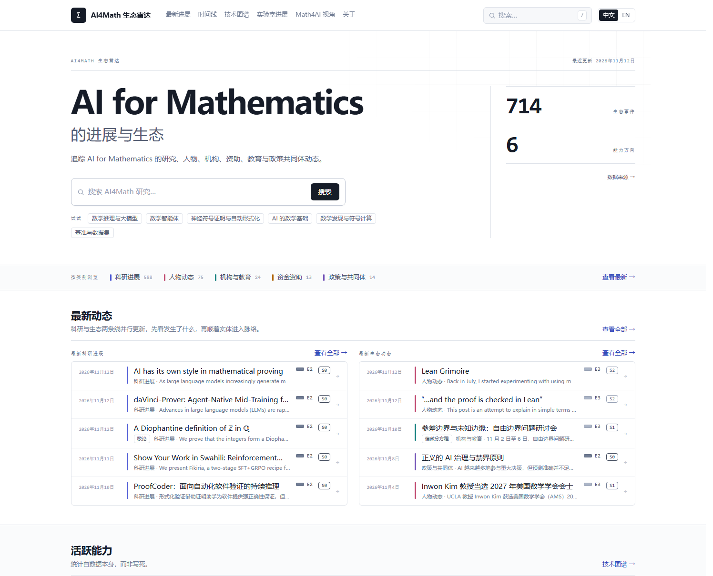

<div align="center">

# ∑ AI4Math Ecosystem Radar

**An ecosystem intelligence platform for AI for Mathematics — tracking events, not just papers.**

Turning progress scattered across arXiv, conference proceedings, lab blogs, university news
and foundation announcements into one filterable, traceable, navigable timeline.

**English** · [中文](README.md) · [Weekly updates](project_management.md) · [Live site](https://irrelaceable.github.io/ai4math-radar/)

[](https://nextjs.org/)
[](https://react.dev/)
[](https://www.typescriptlang.org/)
[](https://tailwindcss.com/)
[](#how-data-updates)
[](https://vitest.dev/)



</div>

---

## What it is

AI4Math does not advance in papers alone. New methods appear, researchers move, institutions
open joint labs, foundations issue calls, communities publish policy statements — these
events shape a field, yet they are scattered across dozens of sources with different
formats and rhythms.

**AI4Math Ecosystem Radar** puts research progress and five classes of ecosystem events
into a single dataset. Every event keeps its original source link, evidence level and
verification record. Filter by class, classification dimension, time or evidence level, or follow a field on
the timeline to see how it got here.

Current dataset: **714 events** (583 collected automatically by the ingest pipeline), dating back to **1956**. Research progress is described along **2 orthogonal dimensions**: research theme and math topic.

## Design principles

<table>
<tr><td width="33%" valign="top">

### Events, not papers

Papers, models, benchmarks and datasets are **properties of an event**, never a top-level
class. The five ecosystem classes sit side by side: Research, People, Institutions &
Education, Funding, Policy & Community.

</td><td width="33%" valign="top">

### Evidence apart from importance

`evidenceLevel` (E0–E3) says how mature the public evidence is; `sourceTier` (S0–S4) says
where it comes from. They are labelled independently and never merged into one score.

</td><td width="33%" valign="top">

### Automated and traceable

Ingested events go straight into the stream with no manual review queue. Unverifiable
fields stay empty; items without a confirmable source URL are dropped.

</td></tr>
</table>

## Features

| Module | Route | What it does |
| --- | --- | --- |
| Home | `/` | Event totals, active-theme distribution, latest events and recent research momentum |
| Feed | `/latest` | Class / two-dimension classification (theme · math topic) / time / evidence / tier filters, search, card and compact views |
| Timeline | `/timeline` | Year-by-year density overview and class mix; the three newest months open by default, sparse years open fully, dense months group by day; search, deep links, class filter |
| Research Graph | `/graph` | Interactive scatter view for exploring event clusters, followed by a research-theme × mathematical-domain count matrix with links into the event feed |
| Area archive (archived) | `/topics/[topic]` | Legacy six-area archive: area mix, 12-month trend and latest records; removed from all navigation, kept only so old links still resolve. Current classification is documented on the glossary page |
| Event detail | `/research/[slug]` | What happened, key facts, AI involvement, evidence and status, related events, plus **citation links**, **related events** and an in-page **continuous tracking** timeline as separate sections |
| Search | `/search` | Results grouped by event, paper, area, model and benchmark |
| Math Archive | `/math-archive` | Stage one lists published OpenAI and Anthropic benchmarks and specific mathematical problems, original results and resource disclosures; domestic runs appear after measurement |
| Math4AI entry | `/math4ai` | Direction-axis feed: events where mathematics is the method or theory and the object is the AI system (co-primary included) |
| About | `/about` | What the site tracks, the five event classes, how to read the E/S labels, and the public source registry |
| Glossary | `/methodology` | Definitions for all seven label groups: evidence level, source tier, event class, publication status, AI involvement, direction axis and classification dimensions |

**Citation links and related events**: the detail page keeps the two relations apart.
"Citation links" lists works in this event's reference list and later works citing it,
each with a link to the original paper; a citation is a documented link, not a claim that
conclusions carry over. "Related events" groups co-occurring people, institutions, projects
and models into timelines — co-occurrence signals association, not causation. Short chains
collapse to one line, remaining threads stay expandable and long chains mark the current
position.

**Math Archive**: `/math-archive` shows five detailed task cards plus 38 other
mathematical task source cases selected from the timeline, including two independent
evaluations in one chronological list. The 43 source cases include follow-ups to the same problem and aggregate
benchmarks; they are not 43 distinct problems. The page reads
`data/model-benchmark/challenges.ts` and `data/model-benchmark/sourceTasks.ts`, preserving
reported results and sources. Domestic model results appear after measurement and
verification. The timeline document (2026-10-16 edition) underlies the first 52 entries
in `data/lab-archive/records.ts`; three later DeepMind records supplement it. This archive
is not a per-problem input set; executable inputs still need to be extracted.

**Trust model**: evidence levels E0–E3 (independent replication / testable artifact /
research record / originator claim) and source types S0–S4 are labelled separately;
each event may carry multiple sources. Publication status is a separate, fully automatic
axis: an arXiv link derives a preprint and a proceedings/publisher DOI derives `published`,
with no manual annotation step; errata are appended independently. Label definitions live at
[`/methodology`](app/methodology/page.tsx).

<table>
<tr>
<td width="50%"><br><sub>Timeline: yearly density, three newest months open by default, month folding</sub></td>
<td width="50%"><br><sub>Event detail: facts, evidence and original source</sub></td>
</tr>
</table>

## Data and trust model

Each event's evidence level is derived from verifiable links, not a subjective score:

```text
E0 Independent replication  Public third-party replication or verification record (manually labelled)
E1 Testable artifact        Public code / data / formal proof
E2 Research record          Paper, proceedings or technical report
E3 Originator claim         Originator statement only, no record or artifact (including no public material yet)
```

Source tier `S0`–`S4` is labelled separately and resolved in this order: explicit event
override → source catalog table → source-type fallback. arXiv and GitHub are both `S0`.

Data policy:

- Never invent results, arXiv IDs or URLs; leave unverifiable fields empty and drop items
  whose source URL cannot be confirmed.
- The direction axis (ai4math / math4ai / both) is assigned only to research events with a
  `researchArea`. Ecosystem classes — people, institutions, funding, policy — are grouped by
  event class and carry no direction. Research items whose model judgement fails also stay
  empty; `npm run backfill:direction` fills them once a live model is configured.
- Publisher-reported results are labelled at E3 (originator claim) with denominators kept
  (e.g. counted by published statements, not by proven theorems).
- Ingested entries go straight into the stream; there is no manual review queue, and
  corrections are recorded as publication errata.
- Event titles keep the source's original wording and are never rewritten automatically.

## How data updates

The site is a fully static export: data is written to JSON at build time, pages are
exported as HTML, and there is no server process or database. Sources are registered in
`lib/sources/catalog.ts`; each sync appends new events to `data/ingested/`, which are
merged with the bundled events, deduplicated, and turned into the Chinese and English
datasets at build time. Citation links between events are backfilled from OpenAlex
reference lists via `npm run backfill:citations` (idempotent, safe to re-run).

`prisma/` and `DATABASE_URL` are kept for local experiments only: setting them
switches `getStore()` to PostgreSQL, while the published build always uses the
file-based dataset from `data/seed` + `data/ingested` and opens no connection.

Event cards do not maintain a drifting second copy of the news. Every source
record retains its URL and detail page while receiving a stable `eventId`. Incoming records are
routed through four relations: a later development of the same result (SAME_EVENT) appends one
timeline step; a new result under the same project (SAME_PROJECT) creates a new Event linked to
that Project; an independent reproduction or overturning (RELATED_EVENT) draws a relation edge or
correction record instead of overwriting history; everything else stays independent. A media re-report adds a source, never a
progress step. Identity matching uses people / institutions / projects only, and titles naming
different years never merge; ambiguous candidates are judged by the configured LLM only. Curated
links take precedence and are never rewritten by automatic matching. `npm run backfill:tracking`
recomputes non-curated links for the ingest archive and is safe to re-run.

Publishing is handled by [`.github/workflows/publish.yml`](.github/workflows/publish.yml):
on every push to `main`, every 6 hours, or on manual dispatch. Scheduled and manual runs
pull new events first, then rebuild and publish both language sites.

## Running locally

Requires Node.js 20+:

```bash
npm install
npm run dev
```

The Chinese site runs at <http://localhost:3000> and English at
<http://localhost:3001/en/>.

## Roadmap

- [x] Five-class ecosystem event model with trust labels
- [x] Static export with separate Chinese and English builds
- [x] Timeline (density overview, three newest months open by default, density-aware folding, deep links, keyword search)
- [x] Event tracking layer (Event / Update / Source; five-relation routing, one-off records stay independent Events; presented in the in-page "Continuous tracking" section on detail pages)
- [x] Two-dimension classification (research theme / math topic; derived from raw records at build time, absence is information)
- [x] Curated project seeds (DeepSeek-Prover, The AI Scientist; no force-grouping)
- [x] Scheduled ingestion and automated publishing
- [x] Citation graph between events (previous / follow-up edges checked against OpenAlex references)
- [ ] Per-problem benchmark result tracking within areas
- [x] Math4AI and Public math tasks are both first-class entries (direction axis ai4math / math4ai / both, judged by research object → core goal → actual contribution at ingest)

## Contributing

Found an error or want to suggest a source? Open an issue with a verifiable original link;
items without a confirmable source are not merged. Weekly feature updates live in
[project_management.md](project_management.md).

## License

No open-source license has been chosen yet. Until a `LICENSE` file is added, all rights are
reserved; please contact the author before reuse.
