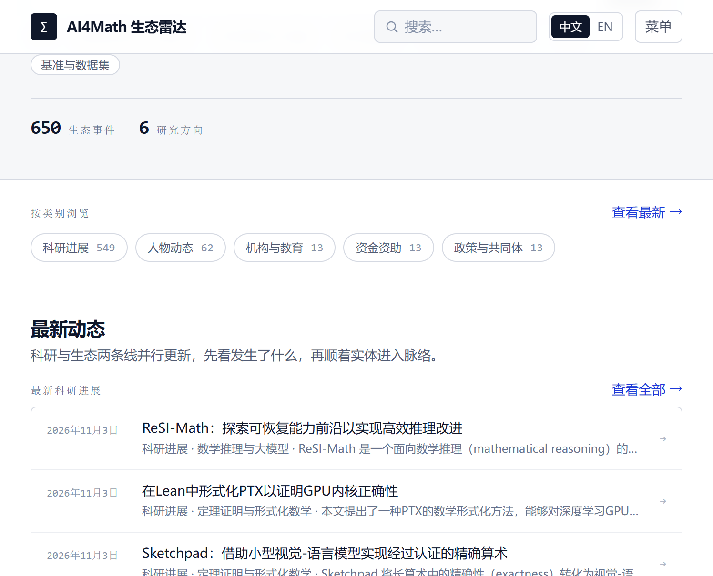
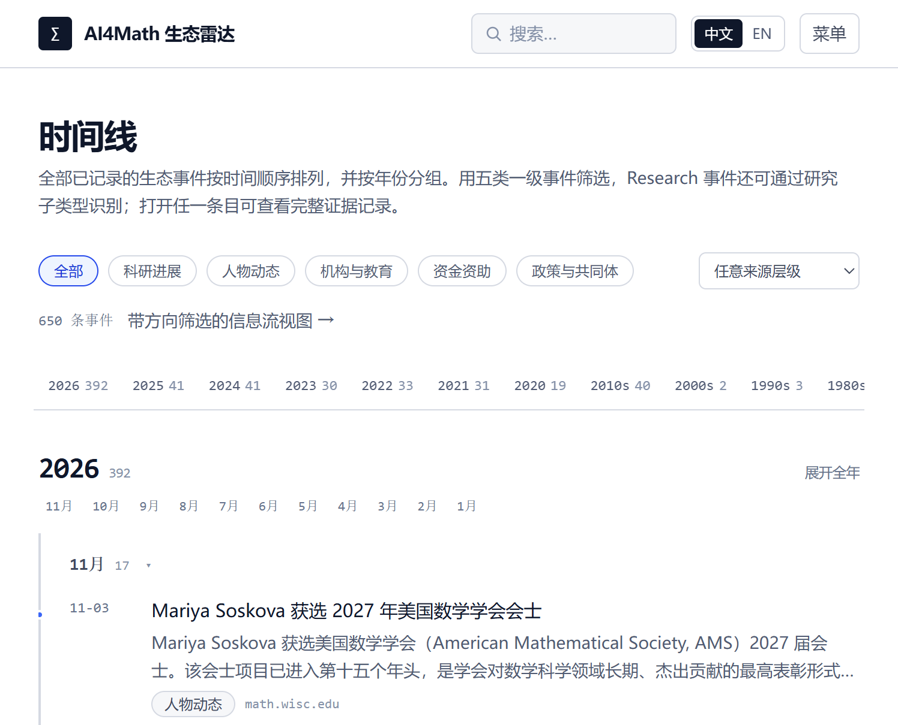
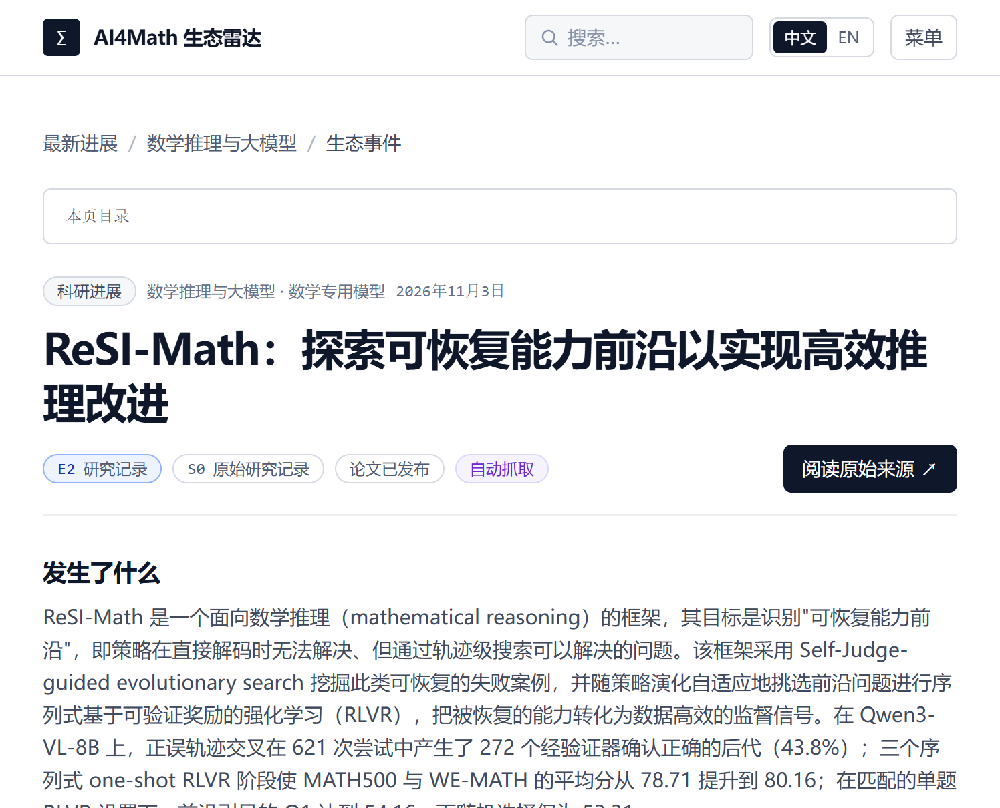

<div align="center">

# ∑ AI4Math 生态雷达

**AI for Mathematics 的生态情报平台 —— 追踪事件，而不只是论文。**

把散落在 arXiv、会议论文集、实验室博客、大学新闻与基金会公告里的进展，
整理成一条可筛选、可追溯、可定位的生态时间线。

[中文](README.md) · [English](README.en.md) · [功能更新](project_management.md)

[](https://nextjs.org/)
[](https://react.dev/)
[](https://www.typescriptlang.org/)
[](https://tailwindcss.com/)
[](#数据如何更新)
[](https://vitest.dev/)



</div>

---

## 这是什么

AI4Math 的进展不只发生在论文里。新方法出现、研究者流动、机构成立联合实验室、基金会开放资助、
社区发布政策声明——这些事件共同决定了一个方向的走向，却分散在几十个来源里，格式各异、更新节奏
不同。

**AI4Math 生态雷达**把六类研究方向和五类生态事件收进同一份数据集，为每条事件保留原始来源链接、
证据等级与核验记录。你可以按方向、类型、时间、证据等级筛选，也可以在时间线上看一个领域如何
一步步走到今天。

当前数据集：**685 条事件**（其中 558 条由采集管线自动收录），最早可追溯到 **1956 年**，覆盖 **6 个研究方向**。

## 核心设计

<table>
<tr><td width="33%" valign="top">

### 以事件为单位

论文、模型、基准、数据集是**事件的属性**，不作为一级分类。五类生态事件并列：研究、人物、
机构与教育、资金、政策与社区。

</td><td width="33%" valign="top">

### 证据与重要性分开

`evidenceLevel`（E0–E4）说明证据成熟到什么程度，`sourceTier`（S0–S4）说明证据来自哪里。
两者独立标注，不合成分数。

</td><td width="33%" valign="top">

### 自动采集，来源可追溯

自动采集直接进入事件流，不设人工审核队列；无法核实的字段留空，来源无法确认的条目直接丢弃。

</td></tr>
</table>

## 功能

| 模块 | 路由 | 说明 |
| --- | --- | --- |
| 首页 | `/` | 事件总量、方向分布、最新事件与近期活跃度 |
| 事件流 | `/latest` | 按类型 / 研究领域 / 时间 / 证据 / 来源筛选，支持搜索、卡片与紧凑两种视图 |
| 时间线 | `/timeline` | 逐年密度概览与年度类别构成；默认展开最近 3 个月，稀疏年份全展开、密集月按日分组；支持关键词搜索、深链与按类别筛选 |
| 研究方向 | `/topics` · `/topics/[topic]` | 六个方向的方向轴构成、近 12 个月走势、子方向与最近记录；详情页含趋势、论文、模型、基准与事件列表 |
| 事件详情 | `/research/[slug]` | 发生了什么、关键事实、证据与状态、同类事件，以及分开成章的**引用关系**与**相关事件** |
| 全站搜索 | `/search` | 按事件、论文、方向、模型与基准分组返回结果 |
| 实验室进展 | `/labs` | 52 条前沿实验室研究档案（2020–2026，按年份分组、可按归属筛选；默认显示成果与来源链接，核查原文收在折叠内），下方另列近期动态 |
| Math4AI 入口 | `/math4ai` | 按方向轴过滤的信息流：数学作为方法或理论、研究对象是 AI 系统的事件（含双向兼有） |
| 关于 | `/about` | 本站定位、五类事件、E/S 标签读法与公开来源清单（原 `/sources` 已并入，旧地址自动跳转；`/research-map` 旧地址跳转到 `/topics`） |
| 标签释义 | `/methodology` | 六组标签的含义：证据等级、来源层级、事件类型、核验状态、AI 参与程度与方向轴 |

**引用关系与相关事件**：详情页把两类关系分开成章。「引用关系」列出本事件参考文献中的工作与
引用本事件的后续工作，每条边都附原始论文链接；引用只表示文献关联，不代表结论被继承。
「相关事件」按人物、机构、项目与模型分组，把本事件放回共现时间线上——共现只表示关联，
不是因果。短链收成一行，其余线索可展开，长链标出当前位置。

**实验室研究档案**：`/labs` 主档来自《Anthropic 与 OpenAI AI4Math 进展时间线》（资料核对截至 2026-10-16），
共 52 条、跨 2020–2026、116 个原始来源链接，录入在 `data/lab-archive/records.ts`。
每条按归属与性质、问题与领域、结果、模型、参与人、人机分工、日期与验证、范围与后续、
原始来源九项登记，中文表述沿用档案原文；英文提供标题、结果摘要、归属与日期口径的译文，
核查细节保留中文原文。它是独立策展数据，**不并入事件数据集**：多条记录共用同一篇论文或同一批
手稿（例如 14–17 条同出 `arXiv:2511.16072`，45–48 条是 722 篇集合的展开样例），并入会按 URL
去重而丢失条目。档案按来源 URL 与站内已有事件互链，近期动态单独列在下方。**前台默认只呈现日期、归属、结果与来源链接**，并给出条目计数、年份分组与归属筛选；九项核查原文与阅读说明收在折叠里，英文站不展示未翻译的中文核查原文；编辑口径与采集机制不对外展示。档案条目与事件详情页均保留讨论区入口（尚未开放）。
档案按归属分为四条线：OpenAI 相关、Anthropic 相关、两家联合支持、独立第三方评测与消化；
45–48 条标为「样例」，说明它们是同一批手稿的抽样，不另计为独立成果。「手稿声称」
「候选证明」「待持续审查」不等于已获独立验证。数据完整性由 `records.test.ts` 校验。

**信任模型**：证据等级 E0–E4（独立复核 / 可检验产物 / 研究记录 / 单方声明 / 无证据）与来源
层级 S0–S4 分开标注；核验历史只增不改。标签定义见 [`/methodology`](app/methodology/page.tsx)。

<table>
<tr>
<td width="50%"><br><sub>时间线：逐年密度、默认展开近 3 个月与按月折叠</sub></td>
<td width="50%"><br><sub>事件详情：事实、证据与原始来源</sub></td>
</tr>
</table>

## 数据与信任模型

每条事件的证据等级由可核验的链接推导，不靠主观打分：

```text
E0 独立复核    多个独立来源交叉验证
E1 可检验产物  公开代码 / 数据 / 形式化证明
E2 研究记录    论文、论文集或技术报告
E3 单方声明    只有发起方自己的公开声明
E4 无证据      暂无公开材料
```

来源层级 `S0`–`S4` 独立标注，按以下优先级解析：事件显式覆盖 → 来源目录表 → 来源类型兜底。
arXiv 与 GitHub 均为 `S0`。

数据政策：

- 不编造结果、arXiv ID 或 URL；无法核实的字段留空，来源 URL 无法确认的条目直接丢弃。
- 方向轴（ai4math / math4ai / both）只标注在有 `researchArea` 的研究类事件上；人物、机构、资金、政策等生态事件按事件类型归类，不带方向轴。模型判定失败的研究条目同样留空，配置真实模型后可用 `npm run backfill:direction` 补齐。
- 发布方自报的结果按「单方声明」记录，并保留分母（例如按已发布语料计数，而不是按已证明定理数）。
- 自动采集不设人工审核队列；更正与撤回以追加核验记录的方式留痕。
- 事件标题保持来源原文，不自动改写。

## 数据如何更新

站点是纯静态导出：数据在构建时写入 JSON，页面导出为 HTML，没有服务端进程，也不需要数据库。
来源清单登记在 `lib/sources/catalog.ts`，每次同步把新事件写入 `data/ingested/`；构建时与内置
事件合并、去重，再生成中英两份数据集。事件之间的引用脉络由 `npm run backfill:citations`
从 OpenAlex 参考文献回填，幂等可重跑。

`prisma/` 与 `DATABASE_URL` 只保留给本地实验：设置后 `getStore()` 会切换到 PostgreSQL，
而发布路径始终使用 `data/seed` + `data/ingested` 生成的文件数据集，不建立数据库连接。

发布由 [`.github/workflows/publish.yml`](.github/workflows/publish.yml) 完成：push 到 `main`、
每 6 小时定时或手动触发；定时与手动运行会先抓取新事件，再重建并发布双语言站点。

## 本地运行

需要 Node.js 20 及以上：

```bash
npm install
npm run dev
```

中文站运行在 <http://localhost:3000>，English 在 <http://localhost:3001/en/>。

## Roadmap

- [x] 五类生态事件模型与信任标签
- [x] 纯静态导出，中英双语独立构建
- [x] 时间线（逐年密度概览、默认展开近 3 个月、密度自适应折叠、深链与关键词搜索）
- [x] 事件脉络（人物、机构、项目、模型、基准共现）
- [x] 定时采集与自动发布
- [x] 事件之间的引用图（前作 / 后续工作，由 OpenAlex 参考文献核对生成）
- [ ] 方向内的逐题评测结果追踪
- [x] Math4AI 作为独立一级入口（方向轴 ai4math / math4ai / 双向兼有，按研究对象 → 核心目标 → 实际贡献自动归类）

## 参与贡献

发现错误或希望补充来源，请在仓库提交 Issue，并附上可核验的原始链接；无法确认来源的条目不合并。
功能更新按周记录在 [project_management.md](project_management.md)。

## 许可证

本项目暂未选择开源许可证。在添加 `LICENSE` 文件之前，默认保留所有权利；如需复用，请先联系作者。
